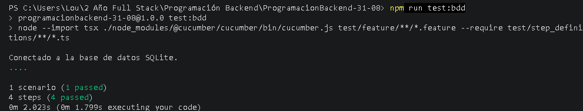

# API REST Backend - Pruebas BDD con Cucumber & TypeScript

* **Estudiante:** Tiziana Ochoa
* **Materia:** Programación Backend
* **Carrera:** Tecnicatura Universitaria en Desarrollo Full Stack (UPC)

Proyecto de backend desarrollado en **Node.js** con **Express**, **TypeScript** y **SQLite**, que implementa metodologías de desarrollo basadas en comportamientos (**BDD** - *Behavior-Driven Development*) con **Cucumber.js** y **Supertest**.

---

## 🛠️ Tecnologías y Herramientas

* **Runtime:** Node.js
* **Lenguaje:** TypeScript
* **Framework Web:** Express
* **Base de Datos:** SQLite
* **Testing & BDD:** `@cucumber/cucumber`, `supertest`
* **Ejecución y Carga de TS:** `tsx`

---

## 📁 Estructura del Proyecto
```
ProgramacionBackend-31-08/
├── node_modules/
├── src/
│   ├── app.ts                 # Configuración del servidor Express y rutas
│   └── server.ts              # Punto de entrada para levantar el puerto HTTP
├── test/
│   ├── feature/
│   │   └── productos.feature  # Definición de escenarios BDD en Gherkin
│   └── step_definitions/
│       └── productos.steps.ts # Implementación de pasos con Cucumber & Supertest
├── test-results-green.png     # Captura de evidencia de ejecución exitosa
├── package.json
└── tsconfig.json
```
⚙️ Configuración e instalación

Clonar el repositorio e instalar dependencias:
```Bash
npm install
```
Compilando el proyecto TypeScript:
```Bash
npm run build
```
🚀 Ejecución
Modo Desarrollo
Para ejecutar la aplicación localmente:

```Bash
npm run dev
```
Ejecución de Pruebas BDD
Para ejecutar el conjunto de pruebas de comportamiento de Cucumber con compilación al vuelo ( tsx):

```Bash
npm run test:bdd
```
Comando director de ejecución:

```Bash
node --import tsx ./node_modules/@cucumber/cucumber/bin/cucumber.js test/feature/**/*.feature --require test/step_definitions/**/*.ts
```
🧪 Pruebas de Comportamiento (BDD)
Se definió la especificación del dominio para la gestión de productos en lenguaje Gherkin :

```Pepinillo
# language: es
Característica: Gestión de productos en la API
  Como usuario de la API
  Quiero registrar y consultar productos
  Para mantener el inventario actualizado

  Escenario: Crear un producto exitosamente
    Dado que la base de datos está disponible
    Cuando envío una petición POST a "/api/v1/productos" con el nombre "Mouse Gamer", precio 25.50 y categoria_id 1
    Entonces el código de respuesta debe ser 201
    Y el producto debe guardarse correctamente con el nombre "Mouse Gamer"
```
📸 Evidencia de Ejecución Exitosa
A continuación se muestra el resultado de la terminal confirmando la ejecución limpia y aprobada de todos los escenarios y pasos BDD:


